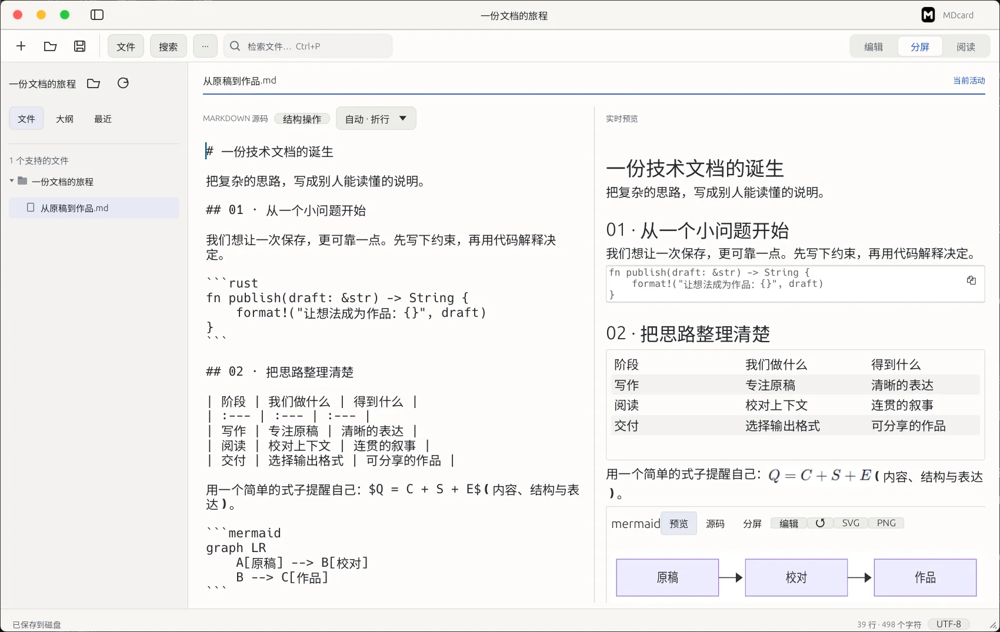

<div align="center">
  
  <h1>MDcard</h1>
  <p><strong>写作、阅读与交付，在同一个本地工作区。</strong></p>
  <p>Rust / egui 原生 Markdown 与文本编辑器 · Windows / Linux</p>
  <p>
    <a href="#download">下载</a> ·
    <a href="https://mdcard-document-journey.wholeangel11.chatgpt.site/">产品页</a> ·
    <a href="#development">开发指南</a> ·
    <a href="docs/README.md">文档</a> ·
    <a href="CONTRIBUTING.md">贡献</a>
  </p>
</div>

[](https://github.com/huwany1/MDcard/actions/workflows/build.yml)
[](LICENSE)

MDcard 面向技术文档、学习笔记与长文写作，把 Markdown 源码、实时预览和阅读视图放在同一桌面应用里。你可以整理表格与内容块、搜索工作区、接着上次的位置阅读，再把稿件导出为文档、图片或幻灯片。



<sub>Windows 应用真实截图。更多画面见[产品页](https://mdcard-document-journey.wholeangel11.chatgpt.site/)；截图与公开样例的来源见[素材说明](website/ASSETS.md)。</sub>

## 用 MDcard 完成什么

| 场景 | 已有能力 |
| --- | --- |
| **写作与校对** | Write / Split / Read 三视图；源码编辑、实时预览与专注阅读；浅色、深色及跟随系统主题。 |
| **整理内容结构** | 表格行列、列表与内容块操作，和 Markdown 源码联动，共用撤销 / 重做历史。[结构编辑](docs/STRUCTURAL_EDITING.md) |
| **查找与批量修改** | 目录树、Quick Switcher、全文 / 正则搜索、替换 Diff 预览与跨文件替换历史回滚。[搜索与替换](docs/GLOBAL_SEARCH.md) |
| **接着上次阅读** | 按文件分别记录最后位置、最远位置与已读状态，区分源码和阅读视图；滚到底部不会自动标记已读。[阅读状态](docs/READING_STATE.md) |
| **表达公式与图表** | KaTeX、Mermaid、PlantUML 和 flowchart.js 本机渲染，适合技术说明与流程梳理。[公式与图表](docs/MATH_DIAGRAMS.md) |
| **导出与分享** | HTML、PDF、PNG、JPEG、DOCX、EPUB，以及 Marp HTML / PDF / PPTX，共九种输出。[导出说明](docs/LOSSLESS_EXPORT.md) |
| **处理多语言文本** | 简体中文、繁体中文、英语、日语、韩语、俄语界面；支持常见文本 / 代码文件与多编码选择、转换保护。 |

想先看看交付效果，可以查看同一份公开稿件的[Markdown 原稿](website/samples/从原稿到作品.md)、[PDF 成品](website/src/assets/exports/manuscript.pdf)和[离线 HTML 下载包](website/src/assets/exports/manuscript-html.zip)。

<a id="download"></a>

## 下载与安装

当前正式版为 **[v0.1.0](https://github.com/huwany1/MDcard/releases/tag/v0.1.0)**，提供完整便携包。

| 平台 | 下载 | 运行环境 |
| --- | --- | --- |
| **Windows x64** | [Windows ZIP · 382.33 MiB](https://github.com/huwany1/MDcard/releases/download/v0.1.0/MDcard-0.1.0-windows-x64.zip) | Windows 11 x64 |
| **Linux x64** | [Linux tar.gz · 369.39 MiB](https://github.com/huwany1/MDcard/releases/download/v0.1.0/MDcard-0.1.0-linux-x64.tar.gz) | Debian 12 / glibc 2.36，X11 桌面 |

1. 下载对应平台的完整包，解压到可写目录。
2. Windows 运行 `MDcard.exe`；Linux 运行 `./mdcard`。
3. 打开已有 Markdown，或从新文档开始；用 `Ctrl+E` 切换编辑、分屏和阅读视图。

完整包已包含公式、图表和导出所需的 Node、Java、Chromium、Pandoc 与字体，**普通用户无需安装开发工具**。请保留解压目录中的 `renderer`、许可证与 `manifest.json`。Linux 仍需系统桌面库，详见下方说明。

<details>
<summary>Linux 系统依赖与运行说明</summary>

在 Debian 12 桌面环境安装所需库：

```sh
sudo apt-get update
sudo apt-get install libx11-6 libxcb1 libxkbcommon0 libxkbcommon-x11-0 libxcursor1 libxrandr2 libxi6 libgl1 libegl1 libvulkan1 mesa-vulkan-drivers libgl1-mesa-dri libnss3 libnspr4 libatk1.0-0 libatk-bridge2.0-0 libatspi2.0-0 libcups2 libdrm2 libdbus-1-3 libgbm1 libasound2 libpango-1.0-0 libcairo2 libfontconfig1 libfreetype6 xdg-desktop-portal xdg-desktop-portal-gtk
tar -xzf MDcard-0.1.0-linux-x64.tar.gz
```

进入解压后的应用目录，运行 `./mdcard`。系统还需可工作的原生文件对话框 portal。

当前正式包的 Linux 桌面验证环境为 Debian 12 / X11；其他发行版、Wayland 和驱动组合仍需单独验证。Linux 原生导出还需要支持 pidfd 的内核（5.3+）及相应权限，见[导出说明](docs/LOSSLESS_EXPORT.md)。

</details>

<details>
<summary>校验下载与确认发行来源</summary>

下载 [SHA256SUMS.txt](https://github.com/huwany1/MDcard/releases/download/v0.1.0/SHA256SUMS.txt)，将对应文件的校验值与其比对：

```powershell
# Windows PowerShell
Get-FileHash .\MDcard-0.1.0-windows-x64.zip -Algorithm SHA256
```

```sh
# Linux
sha256sum MDcard-0.1.0-linux-x64.tar.gz
```

两平台正式包来自同一份[冻结源码 c453689](https://github.com/huwany1/MDcard/tree/c453689171b09463c57cc217fa48974a080854f2)。发行身份以[发行元数据](https://github.com/huwany1/MDcard/releases/download/v0.1.0/MDcard-0.1.0-release.json)和包内 `manifest.json` 为准；`main` 会继续演进，不代表已发布包的构建版本。

</details>

## 常用操作

| 快捷键 | 操作 |
| --- | --- |
| `Ctrl+O` / `Ctrl+S` | 打开 / 保存文档 |
| `Ctrl+E` | 切换编辑、分屏、阅读视图 |
| `Ctrl+P` | 快速查找并切换文件 |
| `Ctrl+F` / `Ctrl+H` | 当前文档查找 / 替换 |
| `Ctrl+Shift+F` | 工作区全文搜索 |
| `Ctrl+Alt+E` | 打开导出窗口 |

## 使用前了解

- **保存与恢复：** 当前没有自动保存和稿件崩溃恢复，请使用 `Ctrl+S` 保存。阅读位置会持久化，但不包含未保存的稿件正文。
- **编辑与文件：** 普通预览只读，支持的表格、公式和图表通过结构工具与源码联动；单文件上限为 16 MiB。内容大幅改写或定位有歧义时，阅读恢复会安全降级。
- **本地处理与联网：** 公式、图表和导出使用本地引擎；HTTP(S) 图片、远程导出资源及点击外链可能访问网络。
- **格式与平台：** 导出效果受目标格式和排版引擎影响，Marp PPTX 为图片式幻灯片；当前无 macOS 正式包，Windows 10 与其他 DPI / 桌面组合未全面验证。详细边界见[功能文档](docs/README.md)。

<a id="development"></a>

## 开发者快速开始

桌面源码使用 **Rust / egui**；公式、图表与导出由本地 renderer 子进程提供；产品网站可以独立构建。

### 1. 构建桌面应用

需要 Git、**Rust 1.92.0**，以及平台编译工具：Windows 使用 Visual Studio C++ Build Tools / Windows SDK，Linux 安装对应开发库。先按[开发说明](docs/DEVELOPMENT.md#桌面程序)准备系统环境，再执行：

```sh
git clone https://github.com/huwany1/MDcard.git
cd MDcard
cargo build --locked
cargo test --locked
cargo run --locked
```

仓库已包含必要字体、图标、vendor 修改与锁文件。仅构建桌面应用无需先安装 renderer；公式、图表与导出需继续准备相应运行时。

### 2. 启用公式与图表

另需 **Node.js 24、Python 3.11+、Java 17+**：

```sh
cd renderer
npm ci --ignore-scripts --no-audit --no-fund
npm run build
cd ..
python scripts/prepare-development.py --browser
cargo run --locked
```

上述步骤准备公式与图表引擎。**完整导出还需单独准备导出运行时**，包括随应用调用的 Node、浏览器与 Pandoc 等；Linux 浏览器系统依赖、环境变量和完整命令见[本地渲染器开发说明](docs/DEVELOPMENT.md#本地渲染器)。

### 3. 检查与独立构建

```sh
# 格式、Clippy、根项目测试、release 构建和 7 个独立 Rust 回归工程
python scripts/check.py --desktop --acceptance

# 完成 renderer 依赖与运行时准备后：构建、真实引擎和进程测试
python scripts/check.py --renderer

# 网站独立构建，无需先编译桌面应用
node website/scripts/build.mjs
```

[GitHub Actions](https://github.com/huwany1/MDcard/actions/workflows/build.yml) 检查 Windows / Linux 桌面构建、Linux renderer 及网站。更多 GUI、导出和性能检查见[维护工具](scripts/README.md)。

| 想了解什么 | 入口 |
| --- | --- |
| 安装工具链、运行时与 Docker 开发 | [开发与测试](docs/DEVELOPMENT.md) |
| 模块关系、数据约束与维护边界 | [架构与维护地图](docs/ARCHITECTURE.md) |
| 搜索、阅读恢复、结构编辑、图表与导出 | [功能文档导航](docs/README.md) |
| 网站构建、预览与素材来源 | [网站说明](website/README.md) |
| 回归、资源制作与其他维护入口 | [工具说明](scripts/README.md) |

## 反馈与贡献

欢迎通过 [Issues](https://github.com/huwany1/MDcard/issues) 反馈问题或讨论功能，也欢迎改进代码、文档、翻译、测试与资源。

- **报告问题：** 附上系统 / 版本、最小复现步骤、预期与实际行为；文档样例请去除私人内容。
- **提交改进：** 从当前 `main` 新建分支，说明解决的问题、变更范围和验证结果，按[贡献指南](CONTRIBUTING.md)提交 Pull Request。
- **涉及稿件操作：** 修改保存、编码、撤销、阅读恢复或跨文件替换时，补充能证明原稿受到保护的回归检查。

## 许可证与第三方来源

MDcard 当前版本的项目自有代码和资产统一采用 **[AGPL-3.0-only](LICENSE)**，涵盖应用、脚本、文档、翻译、示例、网站与品牌资源。完整范围见 [COPYRIGHT](COPYRIGHT) 和[统一授权说明](docs/LICENSING.md)。

第三方源码、依赖、字体、运行时及嵌入素材保留各自许可证，见[第三方来源与例外清单](docs/THIRD_PARTY.md)及 [THIRD_PARTY_NOTICES.txt](THIRD_PARTY_NOTICES.txt)。用户自己的稿件由作者决定授权；导出中嵌入的第三方字体或素材仍遵循其原许可。
