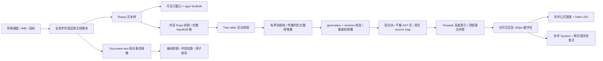

# 大文件高性能渲染与增量解析

本实现面向 MDcard 原生 Rust 桌面应用的主/次文档源码区及主文档源码/预览双栏，64 KiB 起自动启用。保留现有编码、BOM/换行、外部覆盖检查、原子保存、dirty、撤销与六语言界面协议。原生应用没有浏览器 DOM：下文的“挂载”指本帧实际排版的文本行、预览块和驻留纹理；视口查询承担 IntersectionObserver 的可见性判断职责。

本文描述实际代码和测量边界。60fps 指标必须区分 UI update、GPU 完成和显示呈现；当前可取得的最强平台测量是 Windows 原生输入注入到 GPU 完成与实际滚动条拖动时的 GPU 完成间隔，不将其写成显示器 scanout 或 PresentMon 的 presented FPS。

## 数据流



主要模块：`src/large_document.rs` 管理 Rope、事务、全局选区、解析线程和基准遥测；`src/rich_ui.rs` 管理预览高度及媒体结果；`src/syntax_cache.rs` 管理长代码异步高亮；`src/rendering.rs` 提供仅测试开启的绘制完成探针。现有小文档仍走原编辑器路径。

## 文本内核与窗口编辑

Ropey 提供分块共享文本树、O(log n) 字节/字符/行映射和便宜的快照；普通输入提交 UTF-8 变更区间，而不是每帧遍历全文检测差异。`Document.text` 是现有保存、结构编辑和搜索事务的兼容镜像：输入时同步 `replace_range` 并递增文档 revision。该 String 镜像的中间插入仍有后缀搬移成本，文档级撤销仍需要快照；因此本实现没有承诺所有操作都达到纯 Rope 的理论复杂度。外部替换、结构变更和 undo/redo 通过显式 revision 触发一次完整事务差异同步，不会每帧比较全文。

源码使用原生 egui TextEdit 的有界窗口适配器。只提供可见行及缓冲区，窗口最多 24 Ki 字符；特别长的单逻辑行再按视口纵向/横向切窗。字符字节映射、选区锚点、Ctrl/Cmd+A/C/X、方向键、Home/End、跨屏 Shift、拖选自动滚动属于完整文档。TextEdit 的局部 undo 禁用，统一使用文档撤销，窗口移动不产生伪编辑。大于 8192 字节的粘贴直接提交文档事务，随后排版有界窗口，避免先让 TextEdit 对大粘贴全文排版。

原生 TextEdit 保留字体、系统剪贴板和 IME 接口；组合输入时固定当前窗口，提交后恢复虚拟化。全局光标与局部状态分开存储。独立测试覆盖正反长选区、跨阈值撤销、100000 中文字符单行在 wrap/no-wrap 下的末尾定位和空闲帧保持。部分逻辑行的测量不能覆盖整行高度，这是 wrap 巨行修复中的关键约束。实际平台 IME 候选/组合过程仍需人工平台验收，已有 Unicode 输入和粘贴不等同于完整 IME 认证。

## 增量解析与并发一致性

Tree-sitter 使用 Rope chunk 回调读取源文，避免为解析 flatten 全文。工作线程独占解析器和语法树，逐个应用 `InputEdit` 的 byte 与 Point 坐标，再以旧树解析。普通正文、标题及引用定义附近的有界窗口（8192 字节以内）在边界状态吻合时进行局部增量更新；标点、中文及换行也可以进入该路径，不依赖“输入是字母所以安全”的判定。围栏、HTML、列表等可能传播到远处的结构变化，或局部边界验证失败，走后台旧整树增量解析。

后台全局重解析可能超过 5ms，单独记录其 `local=false` 耗时，不冒充局部解析。大粘贴和结构传播不阻塞 UI；没有承诺在 Tree-sitter 单次调用内部强行中断线程。取消/切换文档通过 generation 和 revision 隔离过期输出，完整 edit 链仍按顺序保留。待处理快照合并为一个最新任务；结果也只有一个最新槽，另保留最多 2048 条解析计时，防止快速输入积累未消费的 AST 或隐藏被覆盖的慢解析记录。

预览转换按语法块 hash 复用。全局 reference 定义由语法树提取，只向需要它们的预览块补充相应定义。目录复用 CommonMark 标题规则，处理 Setext、强调、代码和转义字符。长段落、引用、列表和表格用事件 AST 平衡分页，跨页重新打开语法上下文；原文富媒体节点先提取，再通过 source map 保留原始 source/body byte spans、容器前缀和换行元数据。禁止把补上的 Markdown wrapper 当成真实源码偏移。

长 fenced code 单独分页，单页最多 64 行和 8192 字节（巨行也受限），保留真实语言、正文与源码范围。代码正文不进入公式解析，因此代码里的 `$x$` 不会变成公式。嵌套容器代码通过 AST 正文和原文映射处理。Syntect 在线程按需高亮，恢复前置 ParseState/HighlightState 检查点，保证跳到中间页仍保留多行注释等状态。独立测试将中间页颜色与全文高亮逐段比较。

## 动态高度、锚点与完整功能

源码按逻辑行、预览按语法块分别使用 Fenwick 索引，查找视口和更新实测高度均为 O(log n)。只为当前视口及上下 420px 缓冲区创建 UI；未见内容采用估计高度，已见内容记录真实高度。宽度、字体或换行设置改变会重建相关估计。预览测量以半像素稳定化，避免长文绝对坐标浮点误差引发高度振荡。

首次测量上方缓冲块时，以顶部可见块及块内像素为锚点，将其 prefix 高度变化补偿到 scroll offset，避免冷渲染将正文向下推移。媒体历史尺寸独立保留，结果淘汰后骨架仍保持已测高度。该策略降低跳动；不将任意未知字体、窗口宽度与首次媒体尺寸的视觉效果宣称为浏览器规范下的“CLS 永远为零”。

全文搜索使用完整文档，返回全局 byte/char 范围；定位先按高度索引滚动，再挂载对应窗口和精确选区。目录跳转使用同样的源文坐标协议。双栏同步传递源文锚点，区分本侧操作与另一侧驱动，防止反馈回路；Home/End 也显式同步，不能只由 offset 差推断。目录本身按可见行虚拟化。大 TXT/代码文档保持纯文本预览语义。

原生窗口标题仅在内容改变时发送 viewport 命令。egui 的 `send_viewport_cmd` 自带 repaint 请求，每帧重发同一标题会造成持续重绘；最终空闲验收覆盖此问题。

## 缓存和资源边界

| 资源 | 上限与淘汰策略 |
| --- | --- |
| 解析任务 / 解析输出 | 各一个最新槽；输入变更链完整；计时最多 2048 条 |
| 普通预览块转换 | 4096 项 / 32 MiB，按访问淘汰 |
| 长块平衡 AST 页与 source map | 512 项 / 32 MiB，按访问淘汰 |
| 主进程公式图表产物 | 1024 项 / 64 MiB hash LRU，超大单结果拒绝入池 |
| 浏览器 worker 产物 | 1024 项 / 32 MiB；浏览器固定 viewport 1024×768 |
| 媒体真实尺寸历史 | 最多 10000 项；切 generation 清理文档状态 |
| GPU 纹理 | 每帧只保留实际可见及缓冲区请求，离屏 `forget_image` |
| 代码高亮结果 | 512 项 / 16 MiB LRU；待处理请求 8 项 |
| 高亮全文上下文 | 最多 8 个 / 16 MiB 共享源码 |
| 高亮检查点 | 每上下文最多 128 个 / 估计 1 MiB，总估计预算 8 MiB |
| 遥测 | 单槽异步写报告；CPU/解析样本 2048，GPU样本 4096 |

检查点字节数是保守的语法状态估算，不是 allocator 精确计数。缓存预算不包含引擎静态数据、Node/Chromium 基础内存、操作系统共享页和字体。RSS 应统计完整进程树；Linux 同时报告 PSS，避免把共享页在多个 Chromium 子进程中重复计算。不能仅凭 Rust 主进程内存较小就声称完整媒体系统内存低。

## 可复现验证

依赖既有 `mdcard-dev` 容器及 renderer runtime，不会在测试中下载引擎。先运行：

```powershell
docker exec mdcard-dev cargo fmt --check
docker exec mdcard-dev cargo clippy --locked --all-targets -- -D warnings
docker exec mdcard-dev cargo test --locked
docker exec -e CARGO_TARGET_DIR=/work/target mdcard-dev cargo test --manifest-path /work/tests/performance-acceptance/Cargo.toml --locked
docker exec mdcard-dev cargo build --release --locked
docker exec mdcard-dev cargo build --release --locked --target x86_64-pc-windows-gnu
```

真实交互与压力脚本：

```powershell
# 13项独立GUI：搜索/TOC/长选区/历史/巨行/同步/长代码
docker exec mdcard-dev python3 /work/scripts/verify-large-document-master.py
# 12000行正文、80混合输入；strict逐项失败退出
docker exec mdcard-dev python3 /work/scripts/benchmark-large-document.py --mixed --strict
# 220个真实公式/图表冷遍历 + 两次完整回访、进程树RSS/PSS
docker exec mdcard-dev python3 /work/scripts/benchmark-large-media.py
# 12000行代码按视口异步高亮、回访复用
docker exec mdcard-dev python3 /work/scripts/benchmark-large-code.py
# Windows：普通语料，随后同长语料加入220媒体；顺序执行以避免相互干扰
powershell -File scripts/verify-large-document-windows.ps1
powershell -File scripts/verify-large-document-windows.ps1 -Media
```

每轮先复制不可变二进制并计算 SHA256，保留 UUID、渲染器、语料大小、原始输入/帧/解析样本、截图及 gate 结果。脚本显式选择测试进程的输入布局并恢复环境；不把系统中文输入法将 ASCII 变成候选词误判为编辑器丢字。报告环境变量仅供基准，正常运行没有 `glFinish` 或持续重绘。

`MDCARD_PERFORMANCE_REPORT` 开启有界报告；`MDCARD_PERFORMANCE_GPU_FINISH=1` 在最后一个 OpenGL paint callback 调用 `glFinish`；`MDCARD_PERFORMANCE_CONTINUOUS=1` 仅在持续帧预算测试开启。Windows callback 记录 QPC 和文档 revision，外部脚本在每次 SendInput 前记录同源 QPC，再匹配该 revision 的 GPU 完成样本。因此真正的注入到 GPU 延迟包含 OS 队列等待，不包含异步报告落盘时间。旧 `input_to_complete_ms` 从 update 起点计时，保留用于诊断，不能代替完整 InputLatency。所有慢帧保留，不按耗时筛掉。

## 验收状态与边界

以下验收使用冻结二进制和独立脚本；较早开发/失败记录保留为问题修复证据，不与最终 hash 混用。

| 原始标准 | 已覆盖的验收与实测口径 |
| --- | --- |
| 高效缓冲区、动态高度虚拟化、TTI<200ms、60fps | Rope + Fenwick；12000+行；实际挂载数量；Windows磁盘open到首GPU完成；真实滚动条往返的全部GPU完成间隔16.667ms预算。物理present/scanout未测得。 |
| 普通击键解析<5ms、输入<16ms、大粘贴不阻塞 | Windows 55次ASCII字母/数字/标点输入，全部parse记录；中文正文与Unicode大粘贴另测，Linux80混合输入另列；QPC SendInput到匹配revision的GPU完成；Unicode大粘贴的输入帧与后台追上。全局fallback耗时另列。 |
| 200+媒体懒渲染、占位、缓存回收与稳定内存 | 220个真实节点冷遍历及两次回访，编译提交不增长、无错误、缓存与驻留纹理上限、进程树RSS/PSS。长代码首屏/尾页/回访提交次数及跨页高亮语义。 |
| 搜索、目录、跨屏复制、同步与自动Benchmark | 独立13项native GUI（含真实CtrlP+ShiftReturn打开大型次文档）；全文exact clipboard/保存/undo；10000行后Unicode搜索、真实TOC按钮、正反Shift和鼠标拖选；两栏Home/End及反向wheel、空闲停止重绘。 |

当前root回归82项、独立Rust一致性验收50项通过。220媒体已测三轮：220次编译且两次回访仍220，产物4.48MB、3个驻留纹理；第一次/第二次回访完整进程树PSS约974369/970249KiB，无线性增长。UUID `132e0ba2-8bfe-439a-8c3a-78ee6cb5c050`；该报告为 `evidence/performance/final-media-secondary-linux/performance.json`，二进制hash在报告内；最终硬件输入/帧门槛另见主验收报告。

平台证据限定Windows RTX4060/OpenGL与Linux X11/Xvfb/llvmpipe。未实际运行macOS、完整系统IME候选矩阵、软件WGPU绘制完成探针或任意第三方字体组合。次级文件编辑窗同样按64KiB分流到独立LargeDocument实例，保留second-editor及secondary_generation，主/次Rope、光标与历史隔离；次级窗为源码视图，无独立preview。字节级保存和结构编辑保护继续由既有回归覆盖。对恶意单个超大HTML/单元格等特殊Markdown结构，AST分页主要按语法边界保证语义，不声称所有任意语法叶子都具有相同排版上限。

## 官方接口依据

- [Ropey](https://docs.rs/ropey/1.6.1/ropey/struct.Rope.html)：持久共享快照、chunk及byte/char/line映射。
- [Tree-sitter Rust接口](https://github.com/tree-sitter/tree-sitter/blob/master/lib/binding_rust/README.md)：`Tree::edit`、旧树增量解析、自定义输入回调；实现以Cargo.lock锁定版本为准。
- [egui ScrollArea](https://docs.rs/egui/0.33.3/egui/containers/scroll_area/struct.ScrollArea.html)：`show_viewport`、外部offset和State存储；原生控件语义依据锁定源码复核。
- [Syntect](https://docs.rs/syntect/5.3.0/syntect/)：ParseState/HighlightState跨行状态恢复。
- [Windows QueryPerformanceCounter](https://learn.microsoft.com/en-us/windows/win32/api/profileapi/nf-profileapi-queryperformancecounter)：与测试端Stopwatch同源高分辨率时钟。


### 最终 Windows 硬件测量

以下两轮使用同一个冻结 Windows SHA256 `508062291ED83E9BA64C44E0B7457BC6D3622423676E1ECC4BA9F8CF34A38DAD`，RTX4060/OpenGL，全部慢样本保留，严格脚本所有门槛通过。

| 指标 | 普通长文 | 长文 + 220媒体 |
| --- | ---: | ---: |
| 语料字符 / 行数 | 141000 / 12000 | 152274 / 13155 |
| 磁盘打开到首屏GPU完成 | 20.6833ms | 17.9370ms |
| 55次普通键解析最大 | 0.1271ms | 0.1400ms |
| 55次真实SendInput→GPU完成最大 | 15.4669ms | 10.2642ms |
| 含大粘贴的输入帧update→GPU最大 | 5.6232ms | 6.3340ms |
| 实际拖动滚动条3次往返样本 | 1138帧 | 1124帧 |
| GPU完成平均帧率 / 最大间隔 | 143.9688fps / 10.2565ms | 143.9609fps / 10.9325ms |
| 间隔超过16.667ms | 0 | 0 |

普通长文报告：`evidence/performance/master-review/windows/result.json`，UUID `567dfc9c-8dd4-48b5-82c2-afec60791b2c`；媒体报告：`evidence/performance/master-review/windows-media/result.json`，UUID `4d3d3df5-c886-4e04-bdd6-498974c2d32e`。快速拖动期间实际需要编译的媒体为40个，全部成功；遍历所有220节点及回访内存门槛由Linux慢巡游单独覆盖。该硬件结果证明所测负载的GPU完成预算，不外推任意设备、任意文档或显示器物理呈现保证。

最终Linux独立13项GUI通过，UUID `603a154c-2573-48cc-802d-49b65f71b528`，SHA256 `d190b2e5df3aaa678d20acce5a2e241dbd373c201422332dd33a85d40947ff3b`；其中189个代码页首屏1次高亮提交，跳尾总3次，回头仍3次；空闲800ms仅10帧。最终独立审阅结论见 `evidence/performance/master-review/ACCEPTANCE.md`。


最终 Linux 80 次混合输入包含中文、中文标点、括号、Markdown 标点和 Enter，解析最大 0.409566ms；12000 行仅排版 68 行，6000 块预览仅挂载 28 块，exact全文复制通过。该轮 `final-mixed-secondary-linux/performance.json`（UUID `9ee89cbc-c4a5-4830-8054-fcf7933ed1c4`）的 OS→report 最大81.69ms包含自动化进程和报告发布，明确不作为input<16ms证据。完整输入延迟由上述Windows跨进程QPC测量覆盖。最终代码脚本 `final-code-secondary-linux/performance.json`（UUID `0e89e4c6-fd52-45c0-a047-d567da0d1469`）同样通过。

### 交付包核对

完整交付包沿用现有 `scripts/package-export.py` 和自带运行时，使用冻结程序重新打包到 `dist/MDcard-0.1.0-export-windows-x64.zip` / `dist/MDcard-0.1.0-export-linux-x64.tar.gz`。包内manifest逐文件哈希与归档内容由 `scripts/verify-large-document-packages.py` 核对，原始结果为 `evidence/performance/packages/verification.json`。可复现命令：

```powershell
docker exec mdcard-dev python3 /work/scripts/package-export.py --windows-exe /work/artifacts/performance/windows/MDcard.exe --linux-exe /work/target/release/mdcard --reuse-stage /work/dist/export/20261020T125158Z
docker exec mdcard-dev python3 /work/scripts/verify-large-document-packages.py
```
