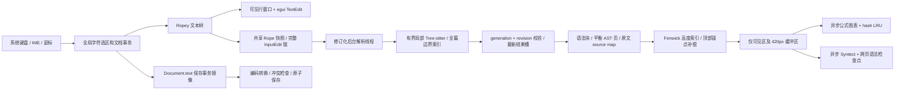

# 大文件高性能渲染与增量解析

本实现面向 MDcard 原生 Rust 桌面应用的主/次文档源码区及主文档源码/预览双栏，64 KiB 起自动启用。保留现有编码、BOM/换行、外部覆盖检查、原子保存、dirty、撤销与六语言界面协议。原生应用没有浏览器 DOM：下文的“挂载”指本帧实际排版的文本行、预览块和驻留纹理；视口查询承担 IntersectionObserver 的可见性判断职责。

本文描述实际代码和测量边界。60fps 指标必须区分 UI update、GPU 完成和显示呈现；当前可取得的最强平台测量是 Windows 原生输入注入到 GPU 完成与实际滚动条拖动时的 GPU 完成间隔，不将其写成显示器 scanout 或 PresentMon 的 presented FPS。

## 数据流

主要模块：`src/large_document.rs` 管理 Rope、事务、全局选区、解析线程和基准遥测；`src/rich_ui.rs` 管理预览高度及媒体结果；`src/syntax_cache.rs` 管理长代码异步高亮；`src/rendering.rs` 提供仅测试开启的绘制完成探针。现有小文档仍走原编辑器路径。

2026-10-26 的内存优化将全篇 Tree-sitter 树限制在 1 MiB 以内；更大的文档以预览已有的 CommonMark parser 流式提取顶层块和全局引用定义范围，不保留全篇 C 语法树。大文档中旧、新上下文都不超过 8192 字节的安全局部编辑仍使用 Tree-sitter 增量校验；语法上下文传播、合并编辑或巨型粘贴转回后台全篇边界扫描。全文、源码范围、rich 节点、虚拟页和阅读映射继续保留，1 MiB 是解析后端选择，稿件支持上限仍为 16 MiB。平衡 AST 页使用借用事件，避免将整篇事件文本转成独立拥有的字符串。诊断、同场景前后测量和恢复回归见[本次内存验收](MEMORY_ACCEPTANCE_2026-10-26.md)。

## 文本内核与窗口编辑

Ropey 提供分块共享文本树、O(log n) 字节/字符/行映射和便宜的快照；普通输入提交 UTF-8 变更区间，而不是每帧遍历全文检测差异。`Document.text` 是现有保存、结构编辑和搜索事务的兼容镜像：输入时同步 `replace_range` 并递增文档 revision。该 String 镜像的中间插入仍有后缀搬移成本，文档级撤销仍需要快照；因此本实现没有承诺所有操作都达到纯 Rope 的理论复杂度。外部替换、结构变更和 undo/redo 通过显式 revision 触发一次完整事务差异同步，不会每帧比较全文。

源码使用原生 egui TextEdit 的有界窗口适配器。只提供可见行及缓冲区，窗口最多 24 Ki 字符；特别长的单逻辑行再按视口纵向/横向切窗。字符字节映射、选区锚点、Ctrl/Cmd+A/C/X、方向键、Home/End、跨屏 Shift、拖选自动滚动属于完整文档。TextEdit 的局部 undo 禁用，统一使用文档撤销，窗口移动不产生伪编辑。大于 8192 字节的粘贴直接提交文档事务，随后排版有界窗口，避免先让 TextEdit 对大粘贴全文排版。

原生 TextEdit 保留字体、系统剪贴板和 IME 接口；组合输入时固定当前窗口，提交后恢复虚拟化。全局光标与局部状态分开存储。独立测试覆盖正反长选区、跨阈值撤销、100000 中文字符单行在 wrap/no-wrap 下的末尾定位和空闲帧保持。部分逻辑行的测量不能覆盖整行高度，这是 wrap 巨行修复中的关键约束。实际平台 IME 候选/组合过程仍需人工平台验收，已有 Unicode 输入和粘贴不等同于完整 IME 认证。

## 增量解析与并发一致性

1 MiB 以内的全篇 Tree-sitter 路径使用 Rope chunk 回调读取源文，避免为解析 flatten 全文。工作线程独占解析器和语法树，逐个应用 `InputEdit` 的 byte 与 Point 坐标，再以旧树解析。普通正文、标题及引用定义附近的旧、新有界窗口（均在 8192 字节以内）在边界状态吻合时进行局部增量更新；标点、中文及换行也可以进入该路径，不依赖“输入是字母所以安全”的判定。围栏、HTML、列表等可能传播到远处的结构变化，或局部边界验证失败，依全文大小转入整树增量或 CommonMark 全篇边界扫描。后者在后台生成一次连续文本供 parser 消费，避免保留大型 C 树；它没有承诺所有尺寸都采用整树增量。reset/generation 变化清空旧边界与 Rope，不能把新缓冲区的合并输入套进上一稿件的局部范围。

后台全局重解析可能超过 5ms，单独记录其 `local=false` 耗时，不冒充局部解析。大粘贴和结构传播不阻塞 UI；没有承诺在 Tree-sitter 单次调用内部强行中断线程。取消/切换文档通过 generation 和 revision 隔离过期输出，完整 edit 链仍按顺序保留。待处理快照合并为一个最新任务；结果也只有一个最新槽，另保留最多 2048 条解析计时，防止快速输入积累未消费的 AST 或隐藏被覆盖的慢解析记录。

预览转换按语法块 hash 复用。全局 reference 定义由当前边界后端提取：小文档使用语法树，大文档使用 CommonMark parser 给出的定义 source span；只向需要它们的预览块补充相应定义。目录复用 CommonMark 标题规则，处理 Setext、强调、代码和转义字符。长段落、引用、列表和表格用事件 AST 平衡分页，跨页重新打开语法上下文；原文富媒体节点先提取，再通过 source map 保留原始 source/body byte spans、容器前缀和换行元数据。禁止把补上的 Markdown wrapper 当成真实源码偏移。

长 fenced code 单独分页，单页最多 64 行和 8192 字节（巨行也受限），保留真实语言、正文与源码范围。代码正文不进入公式解析，因此代码里的 `$x$` 不会变成公式。嵌套容器代码通过 AST 正文和原文映射处理。Syntect 在线程按需高亮，恢复前置 ParseState/HighlightState 检查点，保证跳到中间页仍保留多行注释等状态。独立测试将中间页颜色与全文高亮逐段比较。

## 动态高度、锚点与完整功能

源码按逻辑行、预览按语法块分别使用 Fenwick 索引，查找视口和更新实测高度均为 O(log n)。只为当前视口及上下 420px 缓冲区创建 UI；未见内容采用估计高度，已见内容记录真实高度。宽度、字体或换行设置改变会重建相关估计。预览测量以半像素稳定化，避免长文绝对坐标浮点误差引发高度振荡。

首次测量上方缓冲块时，以顶部可见块及块内像素为锚点，将其 prefix 高度变化补偿到 scroll offset，避免冷渲染将正文向下推移。媒体历史尺寸独立保留，结果淘汰后骨架仍保持已测高度。该策略降低跳动；不将任意未知字体、窗口宽度与首次媒体尺寸的视觉效果宣称为浏览器规范下的“CLS 永远为零”。

全文搜索使用完整文档，返回全局 byte/char 范围；定位先按高度索引滚动，再挂载对应窗口和精确选区。目录跳转使用同样的源文坐标协议。双栏同步传递源文锚点，区分本侧操作与另一侧驱动，防止反馈回路；Home/End 也显式同步，不能只由 offset 差推断。目录本身按可见行虚拟化。大 TXT/代码文档保持纯文本预览语义。

原生窗口标题仅在内容改变时发送 viewport 命令。egui 的 `send_viewport_cmd` 自带 repaint 请求，每帧重发同一标题会造成持续重绘；最终空闲验收覆盖此问题。

## 缓存和资源边界

| 资源 | 上限与淘汰策略 |
| --- | --- |
| 解析任务 / 解析输出 | 各一个最新槽；输入变更链完整；计时最多 2048 条 |
| 普通预览块转换 | 4096 项 / 32 MiB，按访问淘汰 |
| 长块平衡 AST 页与 source map | 512 项 / 32 MiB，按访问淘汰 |
| 主进程公式图表产物 | 1024 项 / 64 MiB hash LRU，超大单结果拒绝入池 |
| 浏览器 worker 产物 | 1024 项 / 32 MiB；浏览器固定 viewport 1024×768 |
| 媒体真实尺寸历史 | 最多 10000 项；切 generation 清理文档状态 |
| GPU 纹理 | 每帧只保留实际可见及缓冲区请求，离屏 `forget_image` |
| 代码高亮结果 | 512 项 / 16 MiB LRU；待处理请求 8 项 |
| 高亮全文上下文 | 最多 8 个 / 16 MiB 共享源码 |
| 高亮检查点 | 每上下文最多 128 个 / 估计 1 MiB，总估计预算 8 MiB |
| 遥测 | 单槽异步写报告；CPU/解析样本 2048，GPU样本 4096 |

检查点字节数是保守的语法状态估算，不是 allocator 精确计数。缓存预算不包含引擎静态数据、Node/Chromium 基础内存、操作系统共享页和字体。RSS 应统计完整进程树；Linux 同时报告 PSS，避免把共享页在多个 Chromium 子进程中重复计算。不能仅凭 Rust 主进程内存较小就声称完整媒体系统内存低。

## 维护与验证

`python scripts/check.py --desktop --acceptance` 运行根项目及独立性能回归。`benchmark-large-document.py`、`benchmark-large-code.py`、`benchmark-large-media.py` 与 `verify-large-document-master.py` 以当前 target/release/mdcard 运行真实 Linux 原生交互，前提见[工具入口](../scripts/README.md)。media 另需完整 renderer；所有计时报告保留独立采样范围。

软件 OpenGL、容器调度、GUI update CPU、输入观测上界与物理呈现延迟不能混为一谈。需要对同一环境和输入重新采样，不能引用历史预算通过作为当前普遍性能保证。
