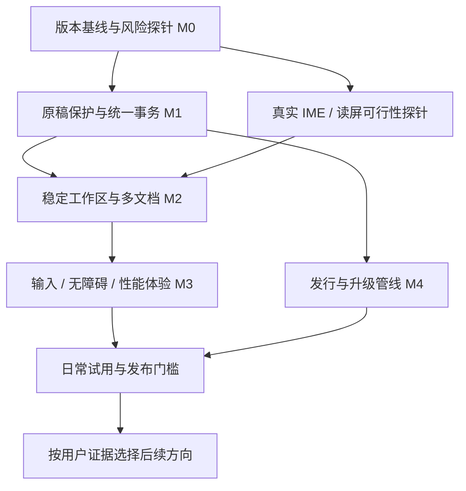

# MDcard 迈向成熟编辑器的路线

决策建议：保留现有原生 Rust 编辑器和已经完成的搜索、结构编辑、公式图表、导出与大文档能力，把接下来的主线收敛为**原稿可找回 → 多文档连续写作 → 中文输入与无障碍可靠 → 普通机器运行可控 → 版本可以放心升级**。先让用户愿意把每天真正的工作放进来，再扩大功能面。

建议定位为：**Windows 优先、面向中文技术写作者，直接编辑本地 Markdown 与常用文本文件、兼顾长文和交付的安静桌面工具。** 学生与一般知识工作者作为后续观察人群，避免第一阶段同时服务过多场景。Linux 明确支持实际验证过的桌面组合；macOS 风格是现有界面语言，不代表已经支持 macOS。现有六语言与编码兼容继续保留。

本文为实施建议，不授权自动实施全部路线。日期为 **2026-10-21，Asia/Shanghai**；代码基线为 `bc5e4db931c9b515004fcab91bb17f2b9b4514d8`，分支 `codex/large-document-performance`。本轮开始时工作区干净；本轮只新增此方案文档，不修改产品代码、分支、运行实例或既有验收报告。

## 1. 当前起点：功能已经不少，成熟度仍需按用户闭环证明

“已实现”表示当前源码与相应历史记录能够支持；“历史验收”只对该报告的程序哈希、语料及平台成立。以下没有把旧截图和旧性能数值变成本轮 GUI 测试结果。

| 能力 | 当前判断 | 可核验依据与实际边界 |
| --- | --- | --- |
| 原生写作、源码/预览/分屏、主题、文件树、六语言 | 已实现，有历史桌面证据 | `README.md:24–39, 51–75, 91–111`；平台主要为 Windows 11 与 Debian/X11/Openbox，不能扩展成所有 Linux 桌面或 macOS 已验证 |
| 多编码、原始 BOM/换行、保存失败保留编辑、外改拒绝覆盖 | 已实现，必须保留 | `src/document.rs:81–135, 144–171, 187–205`；未修改保存复用原字节；改变编码后不能无损表示的内容会拒绝保存；不是字节级任意旧编码编辑保真认证 |
| 表格网格、块重排、列表层级、与源码共用历史 | 已实现，有历史独立验收 | `docs/STRUCTURAL_EDITING.md`；`docs/ACCEPTANCE.md:24–26`。已经有结构操作，不应再规划一次“从零加入表格编辑” |
| 数学、Mermaid/PlantUML/Flow、本地渲染和节点源码编辑 | 已实现，有历史独立验收 | `docs/MATH_DIAGRAMS.md:7–19, 31–41, 56–71`；有长度、时间、缓存、安全语法边界，不能由有限样例推导所有输入绝对安全 |
| 全局搜索、正则替换预览、可恢复跨文件事务、Quick Switcher | 已实现，有历史真实 GUI 与核心故障测试 | `docs/GLOBAL_SEARCH.md:19–35, 39–50`；跨文件是逐文件原子写与补偿，历史目录可跨重启回滚，不是整个文件系统的多文件原子事务 |
| 第二个可编辑文档窗格 | 部分多文档能力已经有 | `src/search_ui.rs:41–46, 194–203, 749–865`；主副文档有隔离与同文件保护；尚非通用标签、稳定工作区、完整会话恢复 |
| PDF、DOCX、HTML、PNG/JPEG、EPUB、Marp 三格式 | 已实现，历史九格式实产物验收 | `docs/LOSSLESS_EXPORT.md:5–11, 28–40`；`evidence/export/master-review/README.md:9–21`。PPTX 为图片式幻灯片；Word/EPUB 分页各有边界；不能再说“缺 PDF 导出” |
| Rope、Tree-sitter、可见区排版、异步代码/媒体与缓存 | 已实现，本轮重跑了核心一致性测试 | `docs/LARGE_DOCUMENT_PERFORMANCE.md:27–45, 49–73`；原生主副源码均有大文档路径，主文档有预览；仍有 String 镜像及快照历史成本，物理显示呈现、完整 IME 候选矩阵未验证 |
| 崩溃后的普通编辑恢复、未命名草稿恢复、正常会话延续 | 明确缺少产品闭环 | `README.md:39, 133`；偏好持久化只覆盖设置（`src/preferences.rs:17–28, 79–92`）。搜索替换快照并不能恢复任意普通打字 |
| 真正中文 IME、读屏与全面键盘使用 | 重要未验证项；读屏桥未接入当前依赖树 | `docs/LARGE_DOCUMENT_PERFORMANCE.md:35, 121`；`Cargo.toml:10` 禁用 eframe 默认特性且未启用 `accesskit`，本轮依赖树检查未发现该包。现有快捷键可用不能替代 NVDA/Orca 实测 |
| 发行、升级、CI、单一版本证据索引 | 有基础，尚未形成统一发布门槛 | `.github/workflows/build.yml:7–26` 只有 root 格式/静态检查/测试/构建与二进制 artifact；缺少独立 crate、Node 引擎、完整包与升级门禁的串联。仓库当前未配置 Git remote，不把已有工作流文件称作远端 CI 已通过 |

最近交付顺序是 `f7cd72b` 结构编辑 → `1d8b07f` 数学图表 → `9f19578` 全局搜索 → `1aa372c` 多格式导出 → `bc5e4db` 大文档架构。路线以这些成果为起点，不从更早的记忆重新计算功能缺口。

### 本轮实际复核

主代理在现有 `mdcard-dev` 容器中重跑 `cargo test --locked --quiet`：**82 passed、0 failed、0 ignored**；重跑 `tests/performance-acceptance`：**50 passed、0 failed、0 ignored**。两套含重叠测试，不相加为 132 个独立案例。本轮未新跑桌面 GUI、IME、读屏、导出九格式或硬件性能；这些仍引用各自历史报告。

本轮核对的冻结 Windows 程序 SHA256 为 `508062291ED83E9BA64C44E0B7457BC6D3622423676E1ECC4BA9F8CF34A38DAD`，与性能记录一致。完整包 Windows ZIP 为 536,967,577 字节（约 **512 MiB**），Linux tar.gz 为 614,101,073 字节（约 **586 MiB**）；Windows 主程序为 99,976,704 字节。完整包散列分别为 `0F93BDDE2388FEB49CC6EDB9AE0816117AD15DA73279C7FC202181886D95EBB6`、`C95E2882B893F8A45FE235119DF34D08E3AFB2AA2C6E684EED993AF178404045`。

历史媒体巡游记录的完整 Rust/Node/Chromium 进程树 PSS 为 1,328,348 → 974,369 → 970,249 KiB；末次约 **0.93 GiB**，见 `evidence/performance/master-review/ACCEPTANCE.md:48–55`。回访不线性增长是已有优点，但不能用 4.48 MB 渲染缓存代表整个应用内存。现阶段“原生”准确描述 Rust 桌面界面；不适合据此宣传“极小包体、极低内存、纯 Rust 导出”。

### 现在就能确定的收敛问题

`README.md:67–69, 137` 已说明搜索和导出，但 `:95, 133` 仍说没有 PDF/HTML 导出或全文搜索；`docs/ACCEPTANCE.md:3–5` 的“当前交付”还指向搜索包。多个能力沿用 `0.1.0` 且保留不同代际包，容易让用户启动旧程序、评审错用旧证据。先修正版本/功能/包/证据的一致性，收益高于再加一种导出格式。

另外，文件树跟随当前文件所在目录（`src/main.rs:974–980`），全文搜索根单独固定（`src/search_ui.rs:92–98`）。这是既有行为，不直接定性为数据错误；对连续跨目录写作却会造成范围认知负担，适合在工作区模型中统一，并保留“从当前文件目录浏览”的显式选项。

## 2. 成功由什么决定

优先服务中文技术写作者的两类真实任务：一类是技术文档和中长篇文章的日常写作；另一类是在本地目录中查阅、修改、检索并交付多份 Markdown。常用代码/配置文件编辑是邻近能力，复杂开发、调试和项目构建留给 IDE。完整学术引用管理、知识图谱和团队协作先保留为潜在方向，必须由用户需求决定是否进入主线。

用户为什么可能改用 MDcard：源码保真、异构编码兼容、图文长稿编辑和本地交付可能组成一条少折返的连续流程。这是**待验证的价值假设**，不是独家能力，也没有证据证明用户会因此迁移。让用户用现用工具和 MDcard 完成同一份脱敏稿件，交替任务顺序，对比总用时、错误、被迫切换工具和中断后找回工作的次数；只有完整流程确实更顺，才继续强化这条定位。

| 用户闭环 | 成熟后的可观察结果 | 先修依赖 |
| --- | --- | --- |
| 写了半小时，程序被强制结束 | 重开后清楚看到可恢复草稿、实际遗漏修改及单列的恢复点年龄；无未保护已提交修改时显示 0 丢失；恢复默认生成副本，原文件和外部新版本仍在 | 稳定 DocumentId、统一编辑事务、恢复持久化、故障注入 |
| 每天在一个目录写 5–20 篇材料 | 工作区范围稳定；文档切换不丢选区/滚动/历史；重开能接着写；同文件多视图共享内容 | 先保证草稿恢复，再做 DocStore、会话与多视图 |
| 中文输入、表格、查找、撤销交替使用 | 输入法候选跟随插入点；组合输入不丢字/重复；每个用户操作按既定事务撤销；全键盘能完成 | 实际平台 IME、焦点状态机、全局坐标、命令分发 |
| 给同事一份 PDF 或 Word | 常用预设可重复；错误可定位并保留旧输出；换设备无需用户寻找一串运行时 | 保留现有导出契约，补预设/交付回归与运行时维护 |
| 在普通集显笔记本看长文 | 可编辑优先；预览慢时有局部状态；内存有边界、空闲不持续高负载 | 最低支持硬件基线、进程树观测、资源调度与历史预算 |
| 升级、移动目录或卸载重装 | 旧草稿、用户文件和设置仍可找到；失败可回退；知道运行版本和数据位置 | 版本化存储、升级夹具、干净安装、签名与发布清单 |

以下是**建议目标，均不是已取得的用户数据或普适保证**：

| 维度 | 拟定门槛与测量方法 |
| --- | --- |
| 原稿保护 | 故障矩阵内不得静默覆盖外部内容、误报保存成功或丢失已确认恢复点；任一可复现严重损坏均阻断试用扩量 |
| 恢复落盘延迟 SLO | 正常可写本地磁盘、所支持负载内，每次编辑到包含它的恢复点确认的延迟，P99 ≤2 秒；保留最大值、超标和失败记录。每次故障分别报告已持久化 revision、故障时最新已提交 revision 和恢复后的 revision；没有尚未持久化的已提交修改时，实际丢失为 0；有遗漏时报告遗漏事务/文本范围及其最早、最晚提交时间。恢复点年龄另列，不能当作实际丢稿。磁盘失败时显示保护暂停及未保护时段；该 SLO 不是硬性 2 秒 RPO 上限 |
| 基本任务 | 10–15 名目标用户试用；预设“导入已有目录 → 写中文图文稿 → 中断/次日续写 → 找回材料 → 交付 PDF/Word”的闭环无指导完成率 ≥90%；同时报告每个环节和完整闭环的成功分母，发现失败后修复再测 |
| 持续采用 | 四周试用中，至少 60% 的有效参与者在第 4 周仍有 ≥3 天使用；分母、退出原因、样本量同时报告。小样本只用于路线决策，不当作市场结论 |
| 输入与布局 | 所宣称支持的 IME/平台组合，规定矩阵逐项通过；字节、提交次数、选区、撤销与候选位置均检查，不把 Unicode 粘贴当 IME |
| 性能 | 先锁定一台 4 核/8 GB/集显的最低参考机；拟以 1 MiB 典型文档 P95 按键提交到 GPU 完成 ≤32 ms、无持续 >100 ms 卡顿作为起点；16 MiB 边界测退化行为。新门槛须先测可行性，不能沿用 RTX4060 结果替代 |
| 发行质量 | 每个候选版本同一 release ID 绑定源提交、工具链、主程序/运行时/归档哈希、测试环境、已知问题和升级结果；不通过的门槛不得用历史记录补票 |

任何“零丢失”只针对已经确认持久化的恢复点及规定故障模型。尚未提交的 IME preedit、最近尚未落盘的编辑、坏盘与整机丢失必须有清楚边界；本地恢复不等于用户自己的离机备份。

## 3. 官方产品对照：借鉴契约，避免追赶功能数量

以下网页均于 **2026-10-21** 查阅。本轮没有安装竞品、没有对竞品做恢复/性能/安全实测；因此只引用官方描述支持有限产品判断。

| 参考 | 官方资料支持的有限结论 | 对 MDcard 的具体启示 |
| --- | --- | --- |
| Typora | [Auto Save](https://support.typora.io/Auto-Save/)（页面更新 2026-09-06）分别描述自动保存与 Windows/Linux 未保存草稿找回；[Launch Options](https://support.typora.io/Launch-Options/)描述重开文件/目录选项 | 日常写作需要中断后继续的体验；恢复草稿应有可发现入口，不能依赖用户寻找隐藏文件夹 |
| Obsidian | [File recovery](https://obsidian.md/help/plugins/file-recovery)描述定期完整快照、设备本地保存，并明确它不等同完整备份 | 恢复点应位于工作目录之外；“跨文件替换历史”“编辑恢复”“离机备份”分开说明，避免用户误解 |
| Zettlr | [Export](https://docs.zettlr.com/en/export/)描述单文件/项目导出、Pandoc 与可复用配置；[Projects](https://docs.zettlr.com/en/file-manager/projects.html)说明文稿集合及顺序 | MDcard 已有多格式引擎，下一步先使常用交付设置可重复。只有真实长稿用户需要时再做多章项目导出 |
| VS Code | [Basic editing](https://code.visualstudio.com/docs/editing/codebasics)区分 Auto Save、未保存备份与 Hot Exit；[Accessibility](https://code.visualstudio.com/docs/configure/accessibility/accessibility)把键盘导航、读屏和可见性作为编辑体验 | 恢复默认不写回原文件；无障碍需验证完整文档语义与焦点，单有快捷键和放大字体不够 |

[Obsidian 插件安全说明](https://obsidian.md/help/plugin-security)提醒第三方插件继承应用权限；[VS Code Workspace Trust](https://code.visualstudio.com/docs/editing/workspaces/workspace-trust)把代码执行与普通阅读区分。这些资料支持把插件/脚本能力放到后续独立信任设计，而不证明 MDcard 当前存在对应漏洞，也不要求照搬一套庞大的插件系统。

## 4. 依赖顺序与阶段路线

一个阶段由可判定闭环退出，不以文件数、功能列表长度或测试总数退出。每阶段仍采用一名实现代理与一名主代理独立验收；产品实现、验收证据、范围调整由主代理统一判断。

投入是**初步工程估算**：按熟悉 Rust 的实现者、1 人日约 6 小时专注工作计，五阶段约 **50–85 人日**，已包含正常缺陷修复、依赖维护、回归与相应复核；不另叠加一份日常维护工时。对尚未知的框架/文件系统/平台问题再留 20%–30% 风险余量。**12–22 个工作周**仅是单开发者每周 5 天全额投入、顺序实施下的换算，不代表 AI 固定产能或交付日期；M0 完成后根据探针与用户观察重新估算。M4 部分工作可穿插，但不因此压缩验证门槛。

| 阶段 | 用户可得到的闭环 | 冻结范围与预计投入 | 退出条件 |
| --- | --- | --- | --- |
| M0 基线收敛 | 知道安装哪个包、运行哪个版本、当前能做什么 | **3–5 人日**：功能/证据索引、版本 build ID、干净包 smoke；各做一个真实 Windows 中文 IME 和 NVDA 探针；测纯文本/媒体内存与启动，不做 UI 大改 | README 与能力索引不再自相矛盾；一个版本可追溯；得到 IME/读屏路线可行性和修复预算 |
| M1 原稿保护 | 强杀后找回命名/未命名文档，外改仍保留 | **12–20 人日**：稳定 DocumentId、统一编辑事务入口、异步恢复记录、恢复界面、故障状态和迁移；暂维持主副窗格能力 | 下节 RP-01–RP-12 全部通过；当前编码/结构/搜索/导出核心回归无破坏 |
| M2 连续多文档 | 打开工作区，切换多份材料，第二天接着写 | **15–25 人日**：固定显式根、DocStore/独立 ViewState、标签/MRU、主副视图、会话保存/恢复、范围与外部变化提示；补安全新建/重命名/回收站删除、素材粘贴/拖入和相对路径搬迁 | 20 个混合文档、同文多视图、外部重命名/目录移动、脏文件关闭及重开逐项通过；粘贴图片路径/同名冲突/另存为和搬迁后的资源仍正确；草稿保护先于会话 UI |
| M3 日常编辑质量 | 中文输入、键盘/读屏、长文与导出都顺手 | **10–18 人日**：解决 M0 探针暴露的问题、IME 完整矩阵、可访问语义/焦点、常用编辑动作与导出预设、最低硬件资源优化 | 所宣称的输入/读屏平台矩阵全通过；核心任务无鼠标可完成；性能数据及退化策略达标；不以添加语法替代修复 |
| M4 发行与维护 | 干净设备可用，升级可回退，问题能定位 | **10–17 人日**：统一 CI/独立测试、完整包、安装与卸载/升级、版本化数据迁移、签名与来源、组件清单、诊断导出、发布回归 | 同候选包双平台验收；旧版数据升级和失败回退通过；发布/支持矩阵与已知限制齐全；试用门槛达标再进入稳定版 |

第一轮用户观察不等 M4：M0 邀请 3–5 人观察现有任务；M1 通过后开启少量、使用副本的日常试用；M2/M3 逐步扩大到 10–15 人四周试用。不得要求试用者用唯一原稿承担尚未关闭的数据风险。

## 5. 下一阶段 M1：可直接交付给实现者的冻结契约

### 5.1 范围、数据与状态

产品范围限于现有主文档和第二文档的普通编辑恢复、未命名草稿及明确恢复入口。先不加入自动写回原文件、任意多标签、同步、云账户或协作。把稳定 DocumentId 与统一事务入口做成可供后续扩展的基础，避免 M1 自己演变成整个编辑器重写。

恢复数据由内部 Unicode 文本、DocumentId、document generation/revision、源路径、磁盘基线指纹及必要原字节、原保存格式、待保存编码/BOM、选区/滚动锚点、版本与校验信息构成。**草稿使用可完整表达文本的内部格式保存，不先按 GBK 等待保存编码转换。** 例如 GBK 文档中输入 emoji，正常保存应继续拒绝有损编码，但崩溃恢复必须仍能找回 emoji 与原来的待保存编码。

恢复目录置于应用本地用户数据目录，和工作区内 `.mdcard-history` 分开。启动页/菜单始终能进入“恢复草稿”；显示来源、恢复时间、可找回的最后 revision、磁盘是否改变和操作结果。普通文件保持普通文件；不把应用数据库变成用户 Markdown 的唯一存储。

建议状态为 `modified → backup_pending → backed_up(revision)`，保存原文件另走 `save_pending → saved(revision)`；失败分别成为“恢复保护暂停”或“保存失败”。只有完整写入、校验并达到规定持久性语义后才能确认恢复点；只有源文件实际写入成功才能显示已保存。两种成功不能互相替代。P99 ≤2 秒是每次编辑到包含它的恢复点确认的延迟 SLO，不是任何时刻最多丢 2 秒的硬性 RPO 保证。故障报告分别记录已持久化 revision、故障时最新已提交 revision 与恢复后的 revision；没有未保护的已提交修改就是 0 丢失，有遗漏则报告遗漏事务/文本范围及其最早、最晚提交时间。恢复点年龄单列，不能用长时间无编辑造成的旧时间戳推算丢稿。界面显示最近恢复点、保护暂停及未保护时段；测量保留最大值与所有异常。

IME preedit 属于尚未提交的交互状态；不能当作最终编辑写入恢复或撤销。Commit 才形成一次源文事务。崩溃前尚未提交的组合串不在已提交编辑的恢复承诺内，界面与文档须避免相反暗示。M1 只要求恢复所需的 Windows 中文提交/取消和恢复窗口的 NVDA/键盘闭环；跨整篇文档的读屏与更多平台输入法矩阵在 M3 验收，M0 只先判断风险与可行性。

### 5.2 写入、恢复与失败语义

每个文档只有一条有序变更入口；源码、表格、块移动、节点编辑、查找替换、编码变更与 undo/redo 都携带 DocumentId 和 base revision。过期操作拒绝/重新生成，后台解析只读不可变快照。M1 可以继续保留 Rope+String 兼容镜像，但不得新增平行权威缓冲。

恢复可先采用**有界的版本快照加原子提交**，不必立即自造复杂 WAL。至少保留最近一份有效完整快照；生成中断/校验失败的新记录隔离，不能覆盖掉最后有效记录。后台写入合并最近任务，但持久化完成确认必须携带实际 revision，较晚返回的旧任务不能误认成最新。若全量快照实测无法满足负载与恢复落盘延迟 SLO，再在同一格式下增加增量日志和周期快照；日志截断只能发生在新完整恢复点持久化后。

恢复默认为新的未保存副本。只有用户选择写回且磁盘仍与基线一致，才通过原保存流程写入；磁盘已有新内容时提供对照/另存为，绝不自动选择“较新的时间戳”。用户正常“放弃编辑”需要记录明确的放弃标记，避免下次启动把已放弃内容当事故恢复；保存、放弃、取消各有独立语义。

磁盘满/无权限时保留内存及最后有效恢复点，明确显示未保护区间并允许另存为；关闭流程继续有原有未保存保护。多个 MDcard 进程各有会话身份、避免互写恢复日志；同路径被另一进程修改继续按外部冲突处理。损坏恢复记录隔离并保留原始字节，能验证的文本片段才提供查看；不能因一个坏文件阻塞全部启动。升级读取旧格式前做兼容备份；旧版不认识新格式时保留、提示并可导出原始记录，不保证它能提取可读正文，也不清空目录。

保存本身已有 `sync_all + persist` 和外改比较。本阶段验证真实文件系统与并发写入边界；断电后目录项持久性、检查与替换之间的竞态、文件 ACL/权限、硬链接及云盘/网络盘行为都是待验证风险，不能把现有代码直接定性为已证实损坏。第一版先承诺经过验证的本地文件系统；其他路径明确范围与保守失败语义。

恢复存储设置容量和保留策略；未恢复/未明确放弃的最新草稿不得因普通 LRU 被淘汰。清理只回收确认安全的旧历史，容量不足要提示。诊断默认不包含正文、完整路径、恢复内容或凭据；发送材料由用户主动选择。应用本地明文恢复不宣称加密存储。

### 5.3 独立验收矩阵

下面是阶段验收标准，不表示当前已通过。故障注入使用临时用户数据/夹具，测试进程必须具有独立 PID、UUID、程序散列与清理记录；不得强杀用户原有实例。

| ID | 触发/场景 | 可判定结果 |
| --- | --- | --- |
| RP-01 | 命名、未命名、主副文档分别编辑后强杀，重启恢复 | Unicode 文本及待保存格式逐字节/元数据对照；恢复入口可见，默认副本，原文件保持原字节 |
| RP-02 | UTF-8/BOM、UTF-16、GB18030、Big5/Shift_JIS、混合换行；GBK 输入 emoji 后编码保存失败 | 最后持久恢复点包含该 revision 对应的全部 Unicode；不因待保存格式不可表示而丢弃恢复；格式和 dirty 状态正确 |
| RP-03 | 文件在 64 KiB 阈值前后切换、16 MiB 支持边界、巨单行及跨屏选区 | 同一 DocumentId/revision 贯穿两条编辑路径；文本、选区、undo/redo 无跨文档串用；超限行为清楚且不伤旧草稿 |
| RP-04 | Windows 中文 IME Preedit/Commit/取消后分别强杀、保存并恢复 | 已提交文本只写入一次；取消组合不产生伪事务；恢复不夹带未提交串，损失边界按说明报告。此处验恢复完整性，完整候选/虚拟窗口及多平台输入矩阵由 M3 承担 |
| RP-05 | 外部改写/删除/移动后恢复；多进程编辑同路径 | 原稿、新外部版本、恢复草稿均有保留路径；无静默覆盖；同路径状态冲突明确显示 |
| RP-06 | 恢复写入时磁盘满、只读、目录不可用 | 不确认未写成的 revision；保留内存及上一有效恢复点；保护暂停可见且可另存；恢复可写后重建成功 |
| RP-07 | 在临时写、校验、替换前后、旧版清理等边界确定性强杀 | 只能出现完整旧恢复点或完整新恢复点；部分尾部隔离；恢复失败不删除原文件/最后有效记录 |
| RP-08 | 源码、表格/块、节点编辑、替换、编码及撤销连续交错 | 唯一事务序列与持久化 revision 一致；恢复到点后得到该点的完整状态；不重复执行有副作用的事务 |
| RP-09 | 一次保存成功、一次放弃、一次取消、保存失败后退出 | 成功保存不留下假脏状态；明确放弃不被错误复活；取消保留编辑；失败不误删恢复记录 |
| RP-10 | 旧版本数据迁移、损坏/未知版本日志、重复启动 | 可回到最后有效旧格式或隔离损坏项；未知格式保留并可导出原始记录，不要求提取可读正文；一个坏文档不阻断其他恢复 |
| RP-11 | 典型小文档、1 MiB、16 MiB 连续编辑与媒体后台同时运行，另测全部落盘后长时间无新编辑再强杀 | 记录提交到包含该编辑的恢复点确认的 P50/P95/P99/最大值、异常及过期写入；报告持久化/故障时最新提交/恢复后的 revision 和遗漏事务/文本范围及其提交时间，恢复点年龄单列；无未保护已提交修改时为 0 丢失；UI 和内存没有无界队列 |
| RP-12 | 六语言和窄窗检查；Windows NVDA/键盘进入恢复、重试/另存为/放弃 | 恢复窗口动作可达、焦点返回清楚；错误与“已恢复/未保护”可读；不依赖颜色、隐藏目录或鼠标。整篇文档语义导航及 Linux 读屏在 M3 验收 |

测试采用多种证据：核心状态机/真实文件故障注入验证字节，随机操作序列与参考缓冲对照验证事务，实际桌面验证可发现入口与 IME；不把复制实现逻辑的单元测试视为充分验收。物理断电耐久性若尚无实机或虚拟机故障模型证据，仍标为未验证。

## 6. 架构选择：保持哪些，如何渐进改，什么证据才足以替换

| 部分 | 建议 | 触发进一步改变的证据 |
| --- | --- | --- |
| Rust/eframe 原生 UI | 保留，先做真实 IME 与 AccessKit/语义探针；补命令路由、焦点与读屏文本视图 | 严重必要任务出现一个可靠最小复现，经平台对照确认框架约束且现有 API/补丁路线成本不可接受，即可触发限时的可替换编辑控件最小样机 A/B；用相同 IME/读屏/大文档矩阵比较，复用文档/编码/搜索/导出领域层。不因界面“像网页”或代码长而整体换框架 |
| Ropey/Tree-sitter/虚拟化 | 保留现有成果，持续用全量解析作差分参考 | 在规定语法/Unicode/容器边界出现可复现语义错误或最低硬件不达标，先局部修正与降级；没有证据不引入第二套完整编辑内核 |
| `Document.text` String 镜像与快照 undo | M1 保留并封装，M2 经统一事务逐步收回直接写入 | 16 MiB/连续 1000 操作、多文档压力中，历史占用超过明确预算或中间插入持续卡顿。再切 delta undo、分块持久快照和 Rope 主存；每步以独立编码/结构/搜索/导出回归放行 |
| 主副文档状态 | 从当前保护规则迁移为 `DocumentId → DocumentSession` 与独立 ViewState | 同一文件多视图需要共享缓冲与历史；视图只拥有选区/滚动/模式。无需等待出现丢数据才收敛身份；但不能声称当前已存在同文件双缓冲损坏 |
| Markdown 解析与预览/导出 | 冻结现有支持方言与容错规则，建立跨管线 golden corpus | Tree-sitter、pulldown-cmark、导出 JS 在代码、货币、引用、数学、嵌套容器发生一致性差异时，用同语料定位并按方言契约修复；不要靠全文重写 Markdown 规范化来“统一” |
| Node/Chromium/Java/Pandoc | 保留当前已验证能力和运行时隔离；补版本清单、漏洞跟踪与重建回归 | 打开普通文本就长期启动不需要的引擎、最低硬件压力失败、版本更新无法维护或体积成为真实流失原因。先测懒启动/空闲退出/可选引擎包，不直接承诺纯 Rust 重做排版 |
| 索引与目录树 | 统一 WorkspaceId/显式根、忽略规则、内容与路径事件；保留已有后台与预算 | 文件树和搜索不同范围给用户造成可重复误操作；频繁全读在大工作区/电池上明显昂贵。按证据加入系统 watcher，并保留补偿扫描；不把 watcher 当完全可靠事实源 |

建议的渐进顺序：新增事务门面 → 将每类编辑调用迁入 → 为主副文档统一身份与提交协议 → 分离视图状态 → 最后根据数据移除 String 镜像或替换文本控件。`main.rs` 行数只是维护信号，不是重写理由。迁移期间每个阶段都应能独立发布和回退，不能同时切存储、解析器、UI 与恢复格式。

M2 的文件工作流也必须服从这条事务边界：素材粘贴先安全落到工作区素材目录，处理同名文件后插入相对引用，失败不留下假的图片链接；另存为、外部重命名、根目录搬迁要更新文档身份与资源基准。是否改写引用必须明确可预览、可回退，不能凭一个路径匹配批量修改全部正文。无法可靠辨识的外部移动保留旧缓冲和恢复点，由用户重新定位，不静默认成另一个同名文件。

已经值得继续复用的组件包括 Ropey、Tree-sitter、encoding_rs、Rust regex、Syntect、KaTeX/MathJax、Mermaid、PlantUML、Pandoc。网络同步、CRDT、插件宿主、字体/排版引擎、密码学与自动更新机制都不应在本轮自行从零发明；真正需要时选择维护中的实现，再验证许可、能力、安全边界和平台适配。依赖复用不能代替集成测试，也不能免除捆绑运行时的维护责任。

## 7. 输入、无障碍、性能和资源的实际难点

中文输入优先测试 Windows 11 微软拼音和一种常见第三方输入法；Linux X11 至少 IBus/Fcitx5 中实际支持的组合。Wayland 单独列试验支持，完成真实桌面输入/剪贴板/文件 portal 证据后再扩大声明。矩阵覆盖组合跨行、候选选择、Esc 取消、焦点丢失、切换模式、缩放/高 DPI、虚拟窗口边缘、64 KiB 阈值、主副文档和 undo。特别检查长 preedit 期间滚动/缩放/切焦点后的候选窗口位置，以及提交/取消后跨虚拟窗口的光标与文本。日文/韩文也需要真实组合输入，不能由六语言界面与字体覆盖推断已验收。

无障碍在 M0 先做 Windows NVDA 风险探针，M1 完成恢复窗口的 NVDA/键盘闭环；M3 再完成打开、编辑、选区、保存失败和关闭文档的完整 Windows NVDA 场景，再验证 Linux Orca。启用桥接特性只是入口。虚拟化只挂载局部文本，因此 M3 读屏必须能取得完整文档的分页语义与准确选区；焦点要能离开编辑器、返回模态窗口的触发位置。还要测高对比度、系统缩放、减少动画和不依赖颜色的 dirty/错误/搜索提示。若某平台读屏未完成，发布说明应直接列明限制。

性能关注的是完整使用过程：冷启动、第一段可输入、实际按键到绘制、快速滚动、连续撤销、搜索和保存、内存回收、空闲 CPU 与进程生命周期。沿用现有原始样本与完整进程树观测，保留慢样本；增加最低参考机与典型工作日会话。针对 220 媒体的重负载，先报告资源峰值与回落，不把媒体引擎基础内存当泄漏，也不把缓存稳定当整体内存足够低。

设置文档历史和全局缓存预算；达到预算时收缩可安全淘汰的旧历史/清洁预览、停止新的后台任务或提示用户，不丢弃 dirty 文本。超过支持文件大小/复杂度时提供清楚错误或只读/源码退化选择；预览局部失败不能妨碍源文件保存。模型和存储双份造成的成本优先靠测量决定，不以漂亮的理论复杂度取代真实输入数据。

完整包目前自带多种运行时。优化顺序是按需启动、空闲回收、资源预算，之后才考虑包体拆分。保留自带运行时、无需用户另装的完整离线包，再用原型比较“完整包”与“核心程序+可选文档引擎包”；六语言字体、编辑/保存/文件树必须继续离线可用，不能把现有中日韩字体改成首次联网下载。引擎缺少时明确说明受影响的公式/图表/导出能力与包版本，不能在普通打开时静默下载或把缺失功能伪装成成功。是否默认拆包由新测包体/内存改善和试用流失数据决定；维护两套包也有成本，不预设拆包一定更好，不预先承诺未经测量的包体目标。

资源权限也要统一：当前 `README.md:126` 支持 HTTP(S) 图片，`renderer/export.mjs:166–167` 会主动取远程资源。worker 禁网只保护该 worker，不能推导整个应用永不联网。建议明确离线模式、外部图片是否加载及本地资源允许范围；限制 URL 协议、重定向、私网/本地文件与资源大小。具体默认策略通过一轮工作流验证决定，不能以扩大本地读取范围换取“更多文件能打开”。

## 8. 发布、信任与维护方式

每个发布候选只使用一个 release ID；“关于”和诊断中显示版本、提交及渲染后端。源代码版本、嵌入字体、Node/npm、Chromium、JRE、Pandoc、运行时来源/散列和第三方通知集中列清；本轮已存在的来源与实测散列区分继续保留（`renderer/export-runtime-sources.json:4–19, 24–39`）。校验文件完整性不等于证明软件来自可信发布者，正式分发前应完成发布身份与 Windows 签名路线。

CI 补齐 root + 三个独立验收 crate、renderer 实引擎/恶意输入、干净完整包启动、导出实产物校验、版本化升级与回退；耗时硬件 GUI/IME 使用固定设备定期及候选版验收，不能用无头 CI 冒充。打包完成后锁定归档，后续测试只用该包；变更二进制或运行时后重新生成候选版本。

安装/卸载、文件关联、开始菜单/桌面入口、Linux desktop/MIME、稳定应用标识、单实例/多实例规则都属于“每天能用”的闭环。升级保留用户文件、草稿与设置，卸载的默认数据清理策略必须明确；自动更新暂以可验证的新版本提示和手动安装为先，签名、回退和迁移未闭环前不加静默更新。

维护预算从第一版开始计入上述人日估算，不能等功能做完才补回归；稳定版后仍需在正常迭代能力内安排缺陷、依赖更新和发布复验，不为同一工作再次叠加维护百分比。未知平台风险使用第 4 节的 20%–30% 余量，M0 后统一重估。指定每个捆绑引擎的维护人、升级复验清单与安全问题响应流程；跟踪实际受影响范围，不凭依赖版本号直接宣称有漏洞或安全。诊断包默认只含版本、阶段、错误码和去标识化环境，用户选择后才能附正文/文件。

## 9. 用户验证、暂停条件和后续方向

第一轮访谈不只问“还想要什么功能”。观察用户打开已有目录、连续写中文、找回误操作、换文件、处理外改、导出交付的过程，记录失败点、完成时间、替代工具以及为何不愿把真实工作放进 MDcard。先验证“可靠本地写作与交付”是否值得成为主工具，再决定学术、知识管理或通用开发的投入。

四周试用使用匿名本地日记或明确同意的诊断，不默认收集正文。每周汇总：任务成功分母、恢复/保存问题、崩溃、被迫切换工具的次数、最常见三类阻碍、次周仍使用的比例。用户持续回到原工具且理由集中在输入、文件组织或原稿风险时，暂停新格式/新主题，回到相应门槛修复。

以下条件触发路线调整：发现可复现覆盖/草稿损坏则停止扩大试用；IME/读屏探针证明框架硬约束则先比较小原型；资源消耗导致目标机器无法工作则先优化引擎生命周期与分发；四周没有足够用户持续使用，则重新检验定位与工作流，不继续用功能数量证明成功。它们是调整投入的条件，不是推倒全部代码的理由。

稳定版后只选择一条经需求支持的扩展主线：长文项目/书稿交付、轻量双链知识组织、专业引用/投稿，或更多平台。需要引用管理时先复用 Pandoc/citeproc 与现有书目格式，不自己维护参考文献数据库；需要同步时先定义本地冲突和恢复协议，再评估外部服务。可选 AI 若进入，必须独立说明发送范围、预览差异、撤销与失败保护，并允许完全不用账户和网络完成核心编辑。

近期明确不做：插件市场、云账号与自研同步、多人实时协作、图谱/数据库式工作台、完整 IDE、全新排版引擎、无限文件大小、整套所见即所得内核替换，以及为了与竞品对齐而新增更多导出格式。这些方向都可能有价值，但当前没有证据表明它们比原稿保护、中文编辑和连续工作更能决定 MDcard 的成功。

## 10. 决策与证据索引

**下一轮范围建议为 M0 + M1，最先实现的单一产品模块是“普通编辑与未命名草稿的崩溃恢复”。** M0 先让同一版本的功能/文档/包一致，探明 Windows 中文 IME 与 NVDA 路线风险；该模块的完成定义是 RP-01–RP-12 全部通过、最后确认恢复点可找回、默认不覆盖原文件、失败与损失边界可见，并保留当前关键能力回归。M1 独立验收通过后，依据用户观察冻结 M2 的标签与工作区范围。当前已有核心功能继续维护，不因路线图变成“未来功能”而重复开发。

| 证据类别 | 入口 | 本文如何使用 |
| --- | --- | --- |
| 当前源文件 | `Cargo.toml:3–31`；`src/document.rs:8–70, 81–135, 144–205`；`src/main.rs:51–106, 974–980`；`src/search_ui.rs:41–46, 92–98, 194–203, 749–865`；`src/preferences.rs:17–28, 79–92` | 证明已存在的架构/保护与当前缺口；部分风险仅列为待验证，不伪装成复现故障 |
| 当前说明与冲突 | `README.md:39, 49, 61–69, 95, 123–137`；`docs/ACCEPTANCE.md:3–26` | 标出能力已完成、过时描述和版本证据应收敛之处 |
| 大文档历史验收 | `docs/LARGE_DOCUMENT_PERFORMANCE.md:31–45, 119–121, 134–158`；`evidence/performance/master-review/ACCEPTANCE.md:16–54, 63–85` | 只引用其哈希/负载/平台的真实边界、资源数据；不扩展为本轮硬件实测 |
| 搜索/导出/图表历史验收 | `docs/GLOBAL_SEARCH.md:19–50`；`docs/LOSSLESS_EXPORT.md:5–40, 60–68`；`docs/MATH_DIAGRAMS.md:7–19, 56–71`；`evidence/export/master-review/README.md:9–21` | 避免重造已完成模块，保留故障和交付约束 |
| 发行基础 | `.github/workflows/build.yml:7–26`；`renderer/export-runtime-sources.json:4–19, 24–39` | 识别 CI 覆盖缺口与运行时维护责任；不把配置文件当成远端执行证据 |
| 本轮复核 | 主代理重跑 root 82 项与 performance-acceptance 50 项；当前 HEAD、工作区、依赖树、冻结程序/归档散列和包体检查 | 证明本轮核心回归和基线身份；未新测 GUI、IME、读屏、九格式与硬件性能 |
| 外部资料 | 第 3 节官方链接，查阅日期均 2026-10-21 | 产品契约参考，不是竞品实测、市场份额或优越性证明 |
