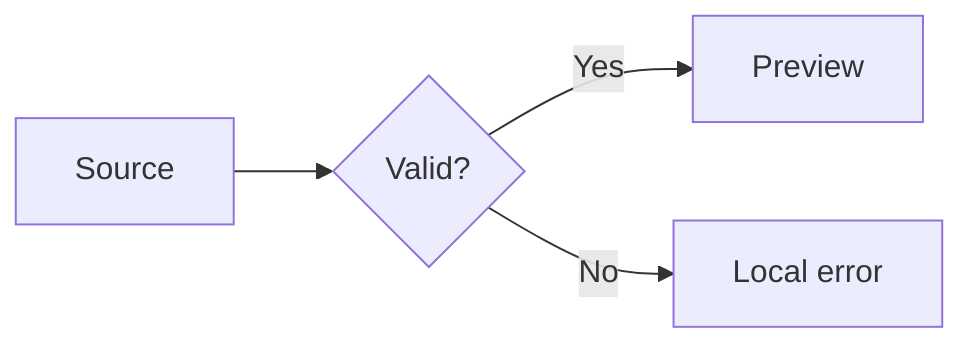
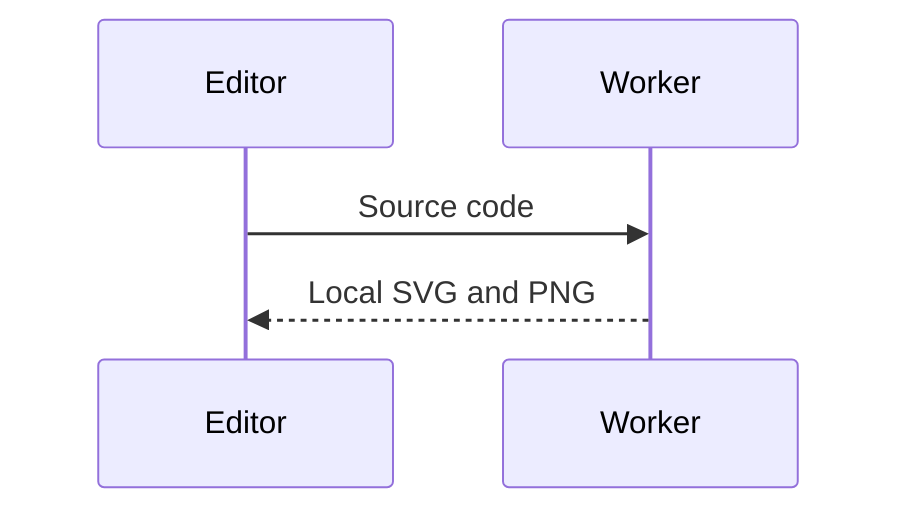
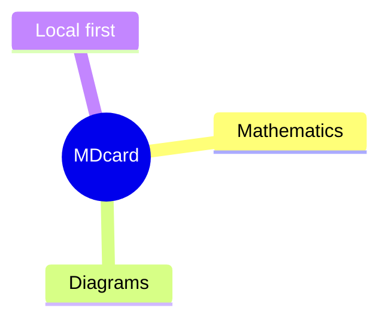
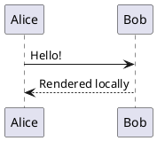
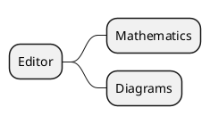

# Mathematics and diagrams

Inline $E=mc^2$ stays beside its words, and \(\alpha + \beta\) stays here.
Currency remains plain: $100, $200 and US$300. A numeric equation is $100$.

$$
\begin{aligned}
\int_0^\infty e^{-x^2}\,dx &= \frac{\sqrt{\pi}}{2} \\
A &= \begin{pmatrix}a&b\\c&d\end{pmatrix}
\end{aligned}
$$

```math
\ce{2H2 + O2 -> 2H2O}
```











```flow
st=>start: Start
op=>operation: Edit source
e=>end: Preview
st->op->e
```

> Formula in a quotation: $a^2+b^2=c^2$.

| Inline | Formula |
| --- | --- |
| Greek | $\Gamma + \Delta$ |

Malformed formulas stay local: $\frac{$ and the next $x^2$ still works.
